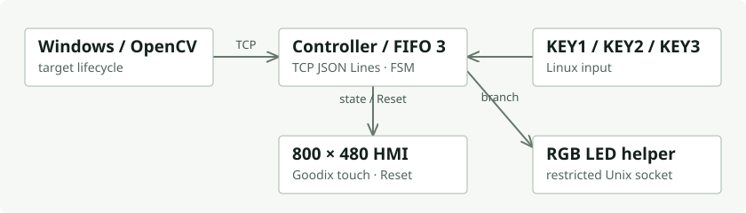
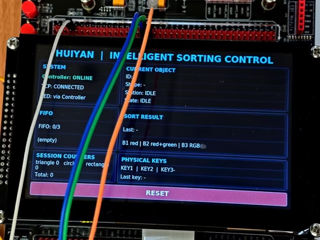

# 慧眼识珠 · i.MX6ULL 控制器与 HMI

PC 识别物料，i.MX6ULL 管理容量为 3 的 FIFO 与三工位状态机。实体 KEY1/2/3 推进队首，RGB LED 表示分流结果，800×480 LCD 显示队列、工位和连接状态，并提供触摸 Reset。

这是已结项的慧眼识珠综合实验的 Linux 实现。我负责视觉链路、控制器、HMI、接口规范、集成与真机验收；[视觉与 PLC 工程](https://github.com/lls144/huiyan-shizhu) 保留另一条团队协作的工业控制路线。视觉计算运行在 PC，板端承担控制与显示。





真实设备照片：LCD 与 PC GUI 读取同一个控制器状态，队列与工位不由界面单独推演。

## 实现重点

| 模块 | 入口 |
|---|---|
| TCP / JSON Lines | [协议](pc/communication/protocol.py)、[板端服务](device/imx6ull/network/tcp_server.py)：按行收发、命令确认、心跳、Reset、状态回读 |
| FIFO / FSM | [core](device/imx6ull/core)：只推进队首；错误工位按键不改变队列 |
| Linux I/O | [key_input.py](device/imx6ull/core/key_input.py)、[output](device/imx6ull/output)：Linux input、受限 LED helper |
| HMI | [hmi](device/imx6ull/hmi)：状态驱动视图、触摸 Reset、断连提示与恢复 |
| 现场运行 | [systemd](device/imx6ull/systemd)、[部署文档](docs/IMX6ULL_DEPLOYMENT.md)：Controller/HMI 普通用户运行，LED helper 独立权限 |
| PC 集成 | [pc/gui](pc/gui)、[vision_dispatcher](pc/communication/vision_dispatcher.py)：目标生命周期与真实控制器状态同步 |

## 一次遮挡，不应变成第二次入队

真机联调发现，手遮住物体后，旧 tracker 只容忍 3 帧丢失，恢复可见时会得到新 ID 并重复入队。修订为已确认目标保留 25 帧恢复窗口，再用类别、IoU / 中心距离匹配。

240.552 s 的真实相机会话处理 7034 帧，约 29.241 FPS，0 failed reads。同一物体短暂遮挡后保持 ID；真正移出并超过窗口后，再进入才产生新 ID。这个结果对应一次记录明确的会话，完整过程见 [验收与调试](docs/ACCEPTANCE.md)。

## 在电脑上先跑控制逻辑

控制器仅依赖 Python 标准库。Linux 下从仓库根目录运行：

```bash
python3 device/imx6ull/controller_main.py --mode desktop --host 127.0.0.1
# 另一个终端运行回归
python3 -m unittest discover -s device/imx6ull/tests -p 'test_*.py'
```

Desktop 模式不读取实体 KEY，不驱动实际 RGB。[运行指南](docs/GETTING_STARTED.md) 分开说明 PC 视觉环境、离线控制器和 Debian 板端部署。

[架构与工位规则](docs/ARCHITECTURE.md) · [文档索引](docs/INDEX.md) · [公开版本与素材说明](docs/PUBLICATION.md) · [个人作品集](https://github.com/lls144)
