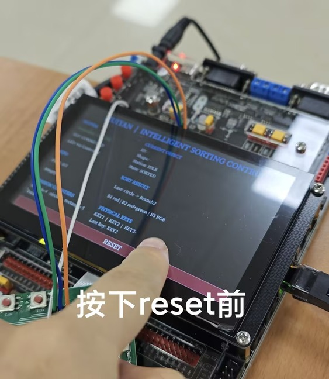
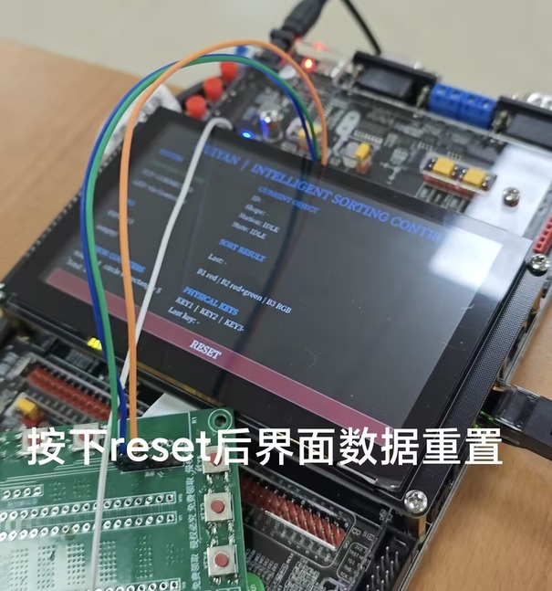

# 从桌面回归到板端验收

[首页](../README.md) · [文档索引](INDEX.md)

## 实体链路

| 记录 | 实际覆盖 |
|---|---|
| [TEST-011](../notes/tests/TEST-011-M9-PC视觉至实体LED端到端验收.md) | PC 视觉事件经 TCP 入队，实体 KEY 与 RGB 完成三种形状的控制路径 |
| [TEST-012](../notes/tests/TEST-012-M10-iMX6ULL-LCD-HMI验收.md) | 800×480 LCD、Goodix 触摸 Reset、状态同步和断连恢复 |
| [TEST-013](../notes/tests/TEST-013-iMX6ULL最终冷启动与演示冒烟验收.md) | 实际冷启动后的服务恢复与三种形状冒烟 |
| [TEST-014](../notes/tests/TEST-014-Windows-RJ45-Python协议冒烟.md) | Windows RJ45 协议连接、heartbeat / state / Reset；故障注入重试另列未验证 |
| [TEST-017](../notes/tests/TEST-017-Windows-Vision-Occlusion-Lifecycle-Robustness.md) | Windows 相机、目标生命周期、真实 i.MX6ULL 队列的遮挡复测 |

这两张原始现场照片展示 Reset 前后界面变化；协议操作、环境和判定条件以 TEST-012 为准，图片本身不用于推算延迟。

## 遮挡重复入队的修复

旧 tracker 在第 4 帧连续 miss 时退出，约为当时帧率下的 0.13 s。手移开后同一物体被当作新目标。新逻辑仅对已确认目标设置 25 帧恢复窗口；同类别且 IoU ≥ 0.30 或中心距离 ≤ 80 px 才恢复原 ID，连续 26 帧丢失才发 EXIT。

TEST-017 中，object 1 从第 185 到 346 帧共 162 帧跨度，含 24 个未检测帧；仍只入队一次。真正移出后第 372 帧 EXIT，重新进入第 600 帧产生 object 2，最终队列为两条合法生命周期对应的命令。

| 会话 | 原记录 |
|---|---|
| 相机 / 输入 | Insta360 Ace Pro 2，DSHOW / MJPG，1920×1080 |
| 时长 / 处理帧 | 240.551791 s / 7034 |
| 处理速率 | 29.241104 FPS |
| 读取失败 / 正常停止 | 0 / true |

[脱敏会话 JSON](../evidence/public/m17-session.json) 保留计数与事件，设备实例标识、网络与本地路径已替换。25 帧约 0.855 s 是该会话帧率下的换算，不是任意负载下的固定时间保证。

验证范围与待补材料

现场记录验证的是形状物料、按键、RGB、LCD 与控制链路；没有实体传送带、电机或工业连续吞吐量验收。本次发布整理只重跑自动化测试，没有重新进行板端实验。完整多工况视频与更长时间的遮挡统计可继续补充。早期记录中“EXE 未开始”等语句保留时间语境，后续代码已加入打包入口，是否可用以具体构建结果为准。

