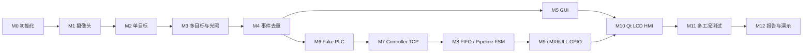

# 实验计划

详细输入、任务、验收、硬件条件以 `../docs/ROADMAP.md` 为准。

## 四周开发顺序

## 状态

- [x] M0 项目初始化
- [x] M1 USB 摄像头稳定采集
- [x] M2 单目标轮廓识别
- [x] M3 多目标识别与抗光照（DONE：5 个真实 camera 场景及双方案证据已审计）
- [x] M4 防重复识别/事件生成（DONE：PC 事件层真实生命周期已审计）
- [x] M5 GUI 上位机（DONE：真实 Insta360 GUI 性能、同步显示与正常关闭已审计）
- [x] M6 Fake PLC 模拟器（DONE：纯离线 16 场景、故障重放与 M4 集成验收通过）
- [x] M7 PC–i.MX6ULL Controller TCP（真实板 TCP smoke 10/10 PASS）
- [x] M8 i.MX6ULL FIFO 与三级 Pipeline FSM（回归、TCP 和实体按键闭环通过）
- [ ] M9 i.MX6ULL 部署与 GPIO（DOING：实体输入 PASS；LED 输出和完整闭环 TODO）
- [ ] M10 Qt LCD HMI
- [ ] M11 多工况系统测试
- [ ] M12 报告、PPT、演示视频整理

> [!warning] 排期说明
> 任务书写明 8 月 31 日至 9 月 25 日共 4 周、覆盖第 17～19 教学周，但原进程表中间阶段名称不完整。本页只给出工程依赖顺序，不冒充缺失的课程排期。

## 当前阶段边界

- 已收到 10 张真实拍摄图片：1 张空背景、每类目标各 3 张；原始图片位于被 Git 忽略的 `test_data/raw/m2/`。
- 离线单目标识别已由项目负责人确认，记录见 [[tests/TEST-002-M2-离线单目标轮廓识别]]。
- [[tests/TEST-003-M2-实时摄像头与ROI验收]] 已完成原机位 manual ROI 和改变机位后 auto ROI 的 8 项真实测试，结果为 PASS。
- M2、M3、M4、M5、M6 均已完成各自范围内验收；2026-09-10 已授权并完成 M7/M8 的 i.MX6ULL Controller 路线，M9 实体输入为 PASS，输出仍待验收。
- M3 的确定性 6 场景合成数据集、双方案离线批处理、JSON/CSV/标注图和自动化测试已完成，见 [[daily/2026-09-04-M3-离线合成验证]]。
- M3 已于 2026-09-07 完成真实摄像头 session：正常、较亮/侧光、较暗、部分遮挡、接触/粘连各保存一帧，并完成图片与结构化数据审计。
- M3 只做到多目标、两种光照方案对比及遮挡/粘连记录，不在 M3 内实现事件状态。
- M4 已单独获授权；确定性状态管理、12 个 detection-sequence 场景、M3 synthetic 集成测试和 live 可选入口已完成，见 [[tests/TEST-005-M4-事件去重离线验收]]。
- M4 已审计真实摄像头 circle 的进入→停留→离场→重入；短暂遮挡保持 ID 明确标注为现场人工观察 + GUI 截图，不冒充 JSON 逐帧证据。
- M5 已获明确授权；PySide6 离线软件、offscreen 自动化测试和 60 秒 synthetic soak 已完成，见 [[tests/TEST-006-M5-GUI离线与实时验收]]。
- M5 已审计同一 camera GUI session 的 1577.142974 秒运行、46235 帧、29.315668 FPS、0 failed read、`error=null` 与 Stop 后 clean shutdown。
- 2026-09-05 负责人另行明确授权 M6 完整离线执行；模拟器现已 DONE，见 [[tests/TEST-007-M6-Fake-PLC模拟器验收]]。后续 i.MX6ULL Controller 授权及实机结果见 [[tests/TEST-008-M9-iMX6ULL部署与TCP验证]]、[[tests/TEST-009-M9-iMX6ULL实体GPIO按键验收]]；M9 输出在获得后续授权前保持待办。
